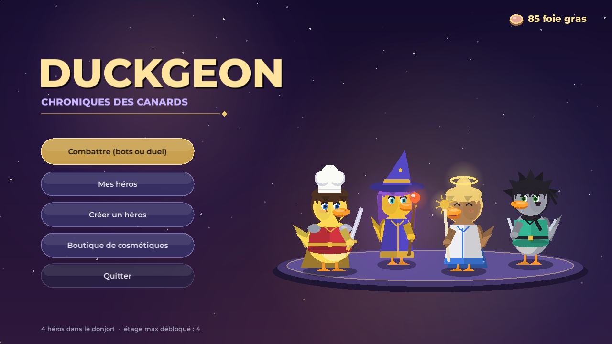
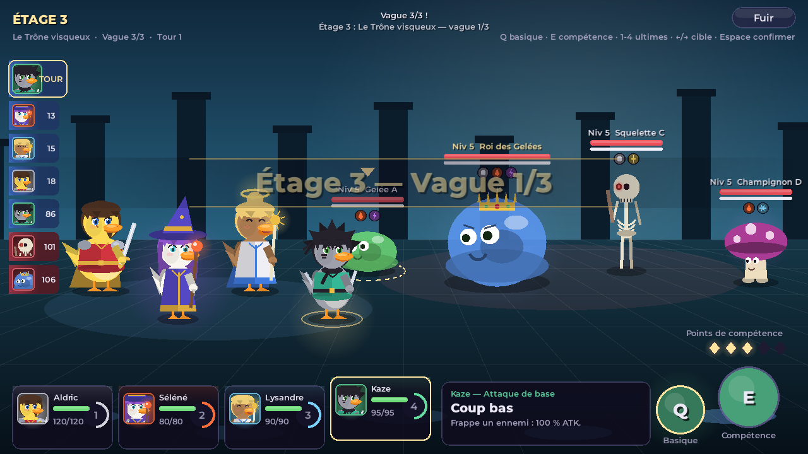
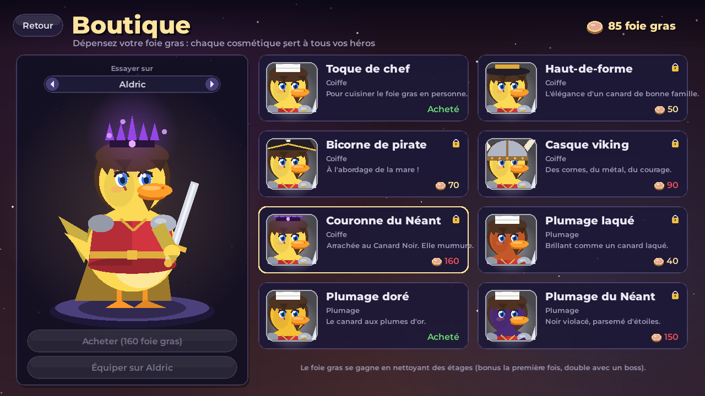
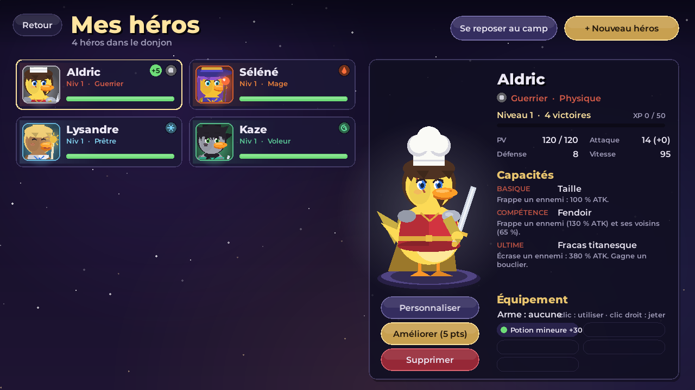
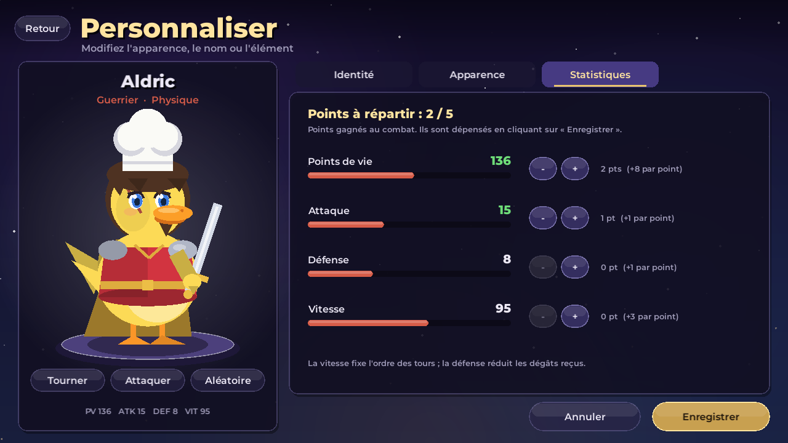
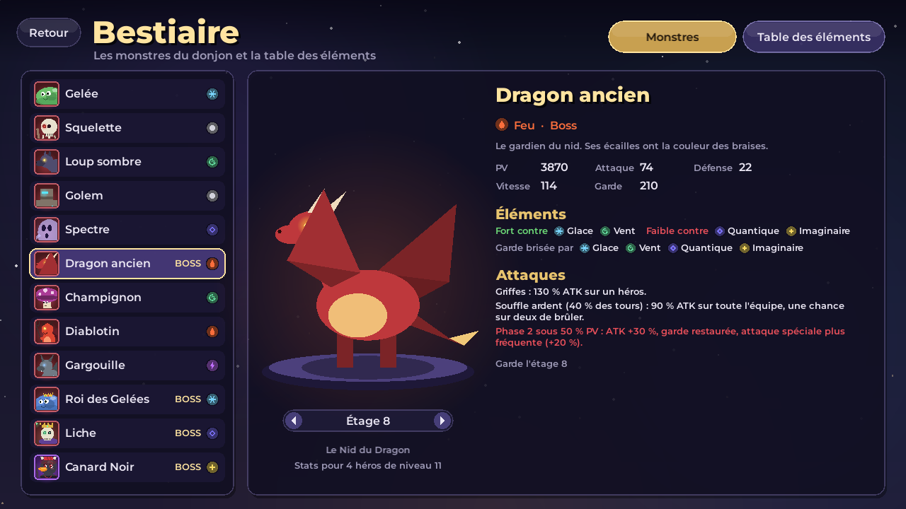
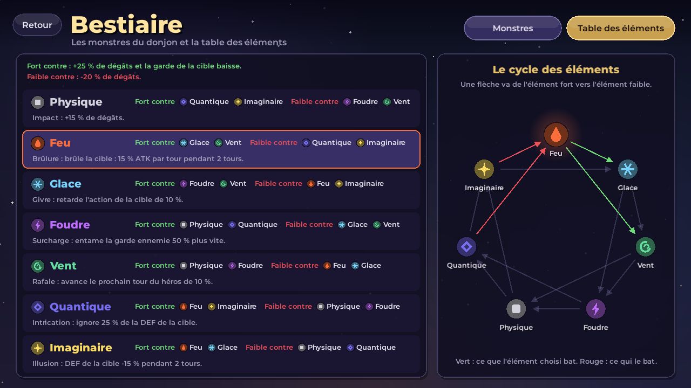
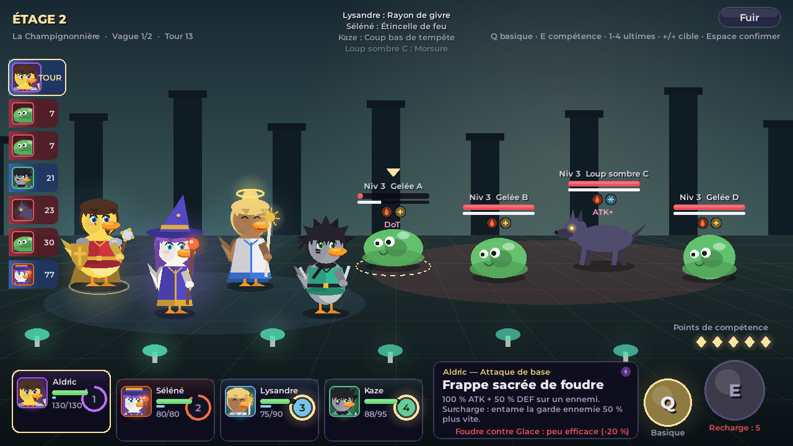
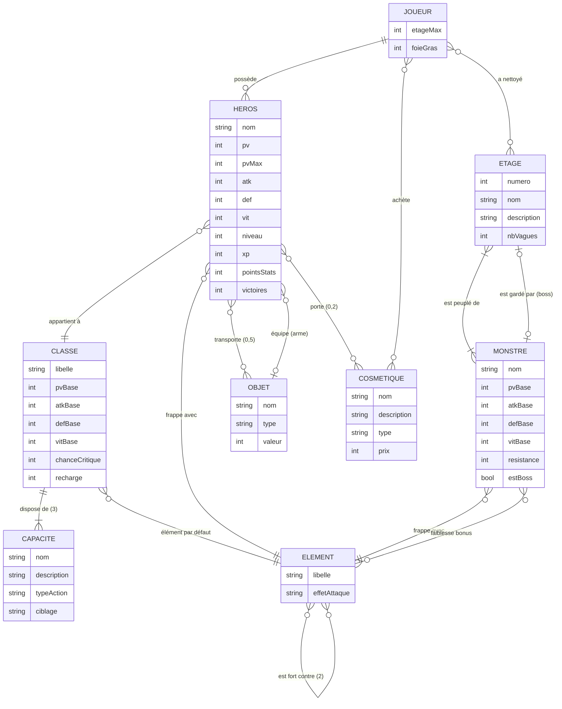

# 🦆 Duckgeon - Chroniques des Canards

**Duckgeon** est un RPG tour par tour écrit en **C** avec **SDL2**. Une équipe de
héros canards descend les 10 étages d'un donjon jusqu'au Canard Noir. Le projet
contient aussi **Le Donjon**, la version terminal : le menu du sujet (création
de personnages, combats, sauvegarde) et **tout le jeu jouable sans interface
graphique** (étages, boss, duels en équipe, bestiaire, boutique).



| | |
|---|---|
|  |  |
|  |  |
|  |  |

## Sommaire

1. [Les deux programmes](#les-deux-programmes)
2. [Installation](#installation)
3. [Comment jouer à Duckgeon](#comment-jouer-à-duckgeon)
4. [Duel en ligne (deux PC)](#duel-en-ligne-deux-pc)
5. [Jouer dans le terminal (Le Donjon)](#jouer-dans-le-terminal-le-donjon)
6. [Sauvegardes](#sauvegardes)
7. [Modélisation Merise](#modélisation-merise)
8. [Architecture du code](#architecture-du-code)
9. [Développement](#développement)

---

## Les deux programmes

| Exécutable  | Nom          | Interface        | Contenu                                                                 |
|-------------|--------------|------------------|-------------------------------------------------------------------------|
| `./duckgeon`| **Duckgeon** | Graphique (SDL2) | Combat en équipe, 10 étages, boss, éditeur de canards, boutique, duel local et en ligne |
| `./donjon`  | **Le Donjon**| Terminal         | Menu du sujet + le jeu complet en texte : étages, boss, duel en équipe, bestiaire, éléments, boutique |

Les deux partagent **la même logique** (`personnage.c`, `combat.c`, `donjon.c`,
`sauvegarde.c`...) et **les mêmes fichiers de sauvegarde** (`donjon.sav` et
`progression.sav`) : une partie commencée dans le terminal se continue dans
Duckgeon, et inversement.

---

## Installation

### 1. Dépendances

Il faut un compilateur C11 (`gcc` ou `clang`), `make`, `pkg-config`, et pour
Duckgeon **SDL2** et **SDL2_ttf**. La version console n'a besoin de rien d'autre.

| Système            | Commande                                                                |
|--------------------|-------------------------------------------------------------------------|
| Fedora             | `sudo dnf install gcc make pkgconf SDL2-devel SDL2_ttf-devel`           |
| Debian / Ubuntu    | `sudo apt install build-essential pkg-config libsdl2-dev libsdl2-ttf-dev` |
| Arch / Manjaro     | `sudo pacman -S base-devel sdl2 sdl2_ttf`                               |
| macOS (Homebrew)   | `brew install sdl2 sdl2_ttf pkg-config`                                 |
| Windows            | via **MSYS2**, voir [Windows pas à pas](#windows-pas-à-pas) ci-dessous   |

### 2. Récupérer et compiler

```bash
git clone https://github.com/evomerse/duckgeon.git
cd duckgeon
make            # compile ./duckgeon (graphique) et ./donjon (console)
```

Pour une seule version : `make gui` ou `make console`.

### 3. Lancer

```bash
./duckgeon      # ou : make run-gui
./donjon        # ou : make run
```

### Windows pas à pas

Sous Windows, on compile avec **MSYS2**, qui fournit `gcc`, `make` et SDL2
dans un terminal de type Linux. Tout se fait dans le terminal
**MSYS2 UCRT64**.

1. **Installer MSYS2** : télécharger l'installeur sur <https://www.msys2.org>
   et le lancer (dossier par défaut `C:\msys64`).
2. **Ouvrir le bon terminal** : menu Démarrer → **MSYS2 UCRT64** (icône
   jaune). Pas « MSYS2 MSYS » ni « MINGW64 » : les paquets ci-dessous sont
   ceux de UCRT64, ils ne seraient pas trouvés ailleurs.
3. **Mettre MSYS2 à jour** :

   ```bash
   pacman -Syu
   ```

   Si la fenêtre se ferme toute seule, la rouvrir (MSYS2 UCRT64) et relancer
   `pacman -Syu` jusqu'à ce qu'il n'y ait plus rien à faire.
4. **Installer les dépendances** (une seule commande, répondre `O`/Entrée) :

   ```bash
   pacman -S --needed git make \
       mingw-w64-ucrt-x86_64-gcc \
       mingw-w64-ucrt-x86_64-pkgconf \
       mingw-w64-ucrt-x86_64-SDL2 \
       mingw-w64-ucrt-x86_64-SDL2_ttf
   ```

   | Paquet                              | Rôle                                         |
   |-------------------------------------|----------------------------------------------|
   | `git`                               | récupérer le projet                          |
   | `make`                              | lancer la compilation (`Makefile`)           |
   | `mingw-w64-ucrt-x86_64-gcc`         | le compilateur C pour Windows                |
   | `mingw-w64-ucrt-x86_64-pkgconf`     | `pkg-config` : trouve SDL2 pour le Makefile  |
   | `mingw-w64-ucrt-x86_64-SDL2`        | fenêtre, clavier, souris, dessin             |
   | `mingw-w64-ucrt-x86_64-SDL2_ttf`    | affichage du texte (polices TrueType)        |

   Le réseau du duel en ligne utilise Winsock, fourni avec Windows : rien à
   installer de plus (le Makefile ajoute `-lws2_32 -liphlpapi` tout seul).
5. **Vérifier** que tout est en place :

   ```bash
   gcc --version                 # doit afficher « gcc.exe (Rev..., Built by MSYS2 project) »
   pkg-config --modversion sdl2  # doit afficher une version (2.x.x)
   ```

   Si `pkg-config` ne trouve pas `sdl2`, c'est presque toujours que le
   terminal n'est pas **UCRT64**.
6. **Récupérer et compiler** (le disque `C:` s'appelle `/c` dans MSYS2) :

   ```bash
   cd /c/Users/$USERNAME/Documents
   git clone https://github.com/evomerse/duckgeon.git
   cd duckgeon
   make
   ```

   On obtient `duckgeon.exe` (graphique) et `donjon.exe` (console).
7. **Lancer**, depuis ce même terminal :

   ```bash
   ./duckgeon.exe
   ./donjon.exe
   ```

8. **Lancer par double-clic** (facultatif) : hors du terminal, Windows ne
   trouve pas les DLL de SDL2. Les copier une fois à côté du jeu :

   ```bash
   ldd duckgeon.exe | grep -i ucrt64 | awk '{print $3}' | xargs -I{} cp {} .
   ```

   Pour donner le jeu à un ami, il suffit alors de lui envoyer le dossier
   (`duckgeon.exe` + les `.dll`).

**Pare-feu Windows** : au premier clic sur *Héberger* (duel en ligne),
Windows demande d'autoriser Duckgeon : cocher **Réseaux privés** et valider.
Si la question a été refusée, autoriser le port à la main (PowerShell en
administrateur) :

```powershell
New-NetFirewallRule -DisplayName "Duckgeon" -Direction Inbound -Protocol TCP -LocalPort 5050 -Action Allow
```

**Police** : Duckgeon cherche une police installée (Montserrat, DejaVu,
Liberation, Arial). Si aucune n'est trouvée, placez un fichier
`assets/police.ttf` ou indiquez-en une :
`DONJON_POLICE=/chemin/vers/police.ttf ./duckgeon`.

---

## Comment jouer à Duckgeon

### Premiers pas

1. Au premier lancement, quatre héros vous attendent : Aldric (Guerrier),
   Séléné (Mage), Lysandre (Prêtre) et Kaze (Voleur).
2. **Créer un héros** : choisissez un nom, une classe (8), un élément (7),
   son apparence (plumage, houppette, yeux, coiffe, cape, aura...) et
   répartissez 10 points de stats bonus.
3. **Combattre** : choisissez la taille des équipes (1 à 4), vos héros et
   l'étage, puis lancez le combat.
4. Après chaque victoire : XP, objets, **points de stats** et **foie gras**.
   Améliorez vos héros dans *Mes héros*, dépensez le foie gras à la *Boutique*.

### Les écrans

| Écran                    | Ce qu'on y fait                                                                 |
|--------------------------|----------------------------------------------------------------------------------|
| **Titre**                | Accès à tout, réserve de foie gras, étage maximum débloqué                       |
| **Mes héros**            | Fiche (stats, XP, victoires, capacités, sac), utiliser/jeter un objet, *Améliorer*, *Personnaliser*, *Supprimer*, *Se reposer au camp* (soigne tout le monde) |
| **Éditeur**              | Onglets Identité / Apparence / Statistiques, aperçu animé en direct              |
| **Préparer le combat**   | Mode (bots ou duel), taille des équipes, choix des héros, choix de l'étage       |
| **Combat**               | Tour par tour, voir ci-dessous                                                   |
| **Boutique**             | Acheter des cosmétiques avec le foie gras, les essayer et les équiper            |
| **Bestiaire**            | Fiche de chaque monstre (stats à chaque étage, attaques, éléments) et table des éléments |
| **Duel en ligne**        | 1 contre 1 à 4 contre 4 entre deux PC, niveau libre ou imposé : héberger (son IP s'affiche) ou rejoindre en tapant l'IP de l'hôte |

### Le combat

Le combat s'inspire de *Honkai: Star Rail* :

- **Ligne de temps** (à gauche) : plus un combattant est rapide (VIT), plus il
  joue souvent.
- **Attaque de base (Q)** : rapporte 1 point de compétence (max 5, partagés par
  l'équipe).
- **Compétence (E)** : coûte 1 point de compétence, effet propre à la classe.
- **Ultime (1 à 4)** : quand la jauge d'énergie est pleine, à lancer à tout
  moment pendant votre tour.
- **Éléments** : voir [ci-dessous](#les-éléments). Frapper un ennemi avec un
  élément fort contre le sien fait plus de dégâts et vide sa barre blanche ; à
  zéro il est **brisé** (dégâts bonus, tour retardé, effet de l'élément). Le
  panneau de l'action indique si l'attaque est efficace contre la cible visée.
- **Boss** : sous 50 % de PV, ils passent en **phase 2** (plus forts, plus agressifs).
- **Défense contre les monstres** : face aux monstres, la DEF d'un héros compte
  moitié moins qu'en duel. Une équipe bien montée prend donc encore des coups.

| Touche              | Action                              |
|---------------------|-------------------------------------|
| `Q`                 | Attaque de base                     |
| `E`                 | Compétence                          |
| `1` `2` `3` `4`     | Ultime du héros correspondant       |
| `←` `→` ou clic     | Changer de cible                    |
| `Espace` / `Entrée` | Valider                             |
| `Échap`             | Retour / annuler                    |
| `F12`               | Capture d'écran (`capture-*.bmp`)   |

**Duel local** : deux joueurs sur le même PC, chacun son tour, de 1 contre 1
à 4 contre 4 (écran « Préparer le combat », mode duel). Les héros sont
copiés à PV pleins : aucune conséquence sur le donjon. Le sélecteur
**Niveau** permet de garder les niveaux actuels ou de mettre tous les héros
au même niveau (1, 2, 3...) pour un duel équilibré.

Pour jouer à deux sur **deux PC différents**, voir
[Duel en ligne](#duel-en-ligne-deux-pc).



### Les éléments

Chaque héros choisit un élément (dans l'éditeur ou avec le menu 8 du
terminal). Il change **trois choses** :

1. **Le nom des attaques** : *Fendoir* devient *Fendoir de feu*, *Fendoir de
   givre*, *Fendoir quantique*... Les soins et les bonus gardent leur nom.
2. **L'effet ajouté à chaque attaque** (une fois par cible et par action) :

   | Élément    | Effet sur les attaques                                      |
   |------------|-------------------------------------------------------------|
   | Physique   | **Impact** : +15 % de dégâts                                |
   | Feu        | **Brûlure** : 15 % de l'ATK par tour pendant 2 tours        |
   | Glace      | **Givre** : retarde l'action de la cible de 10 %            |
   | Foudre     | **Surcharge** : entame la garde ennemie 50 % plus vite      |
   | Vent       | **Rafale** : avance le prochain tour du héros de 10 %       |
   | Quantique  | **Intrication** : ignore 25 % de la DEF de la cible         |
   | Imaginaire | **Illusion** : DEF de la cible −15 % pendant 2 tours        |

3. **Les dégâts selon l'élément de la cible** : chaque élément est **fort**
   contre deux éléments (+25 % de dégâts, la garde baisse) et **faible** contre
   deux autres (−20 %). Les monstres ont aussi un élément, qui compte dans les
   deux sens.

   | Élément    | Fort contre            | Faible contre          |
   |------------|------------------------|------------------------|
   | Feu        | Glace, Vent            | Quantique, Imaginaire  |
   | Glace      | Vent, Foudre           | Feu, Imaginaire        |
   | Vent       | Foudre, Physique       | Feu, Glace             |
   | Foudre     | Physique, Quantique    | Glace, Vent            |
   | Physique   | Quantique, Imaginaire  | Vent, Foudre           |
   | Quantique  | Imaginaire, Feu        | Physique, Foudre       |
   | Imaginaire | Feu, Glace             | Physique, Quantique    |

   Le cycle : Feu → Glace → Vent → Foudre → Physique → Quantique → Imaginaire →
   Feu ; chaque élément bat les **deux suivants**. Aucun n'est avantagé.

Ces informations sont affichées dans la fiche du héros, dans l'éditeur, dans
le bestiaire et pendant le combat.
### Les classes

| Classe       | PV  | ATK | DEF | VIT | Rôle                                   |
|--------------|-----|-----|-----|-----|----------------------------------------|
| Guerrier     | 120 | 14  | 8   | 95  | Encaisse, frappe en zone, bouclier     |
| Mage         | 80  | 20  | 3   | 100 | Dégâts de zone, météore sur tous       |
| Voleur       | 95  | 16  | 5   | 115 | Poison, rafale de coups aléatoires     |
| Paladin      | 130 | 12  | 10  | 90  | Bouclier d'équipe (5 tours d'attente), soin de groupe |
| Archer       | 85  | 18  | 4   | 110 | Tir perforant, pluie de flèches        |
| Prêtre       | 90  | 13  | 5   | 98  | Soins, purification, réanimation       |
| Nécromancien | 85  | 18  | 4   | 102 | Drain de vie, malédiction de zone      |
| Barde        | 90  | 14  | 5   | 108 | Bonus d'attaque, fait rejouer un allié |

Le bouclier du paladin (*Égide sacrée*, 8 + 2 × DEF sur toute l'équipe) ne peut
être relancé qu'après **5 tours du paladin**. Le temps restant s'affiche sous
le bouton de compétence.

### Les 10 étages

Chaque victoire débloque l'étage suivant. Les monstres s'adaptent à l'étage, à
la taille de l'équipe et à son niveau moyen.

| Étage | Nom                   | Vagues | Boss              | Mécanique du boss                          |
|-------|-----------------------|--------|-------------------|--------------------------------------------|
| 1     | Les Caves humides     | 2      |                   |                                            |
| 2     | La Champignonnière    | 2      |                   |                                            |
| 3     | Le Trône visqueux     | 3      | Roi des Gelées    | Invoque des gelées en renfort              |
| 4     | L'Ossuaire            | 3      |                   |                                            |
| 5     | La Forge oubliée      | 3      |                   |                                            |
| 6     | La Crypte de la Liche | 3      | Liche             | Frappe toute l'équipe et se soigne         |
| 7     | Les Remparts gris     | 3      |                   |                                            |
| 8     | Le Nid du Dragon      | 4      | Dragon ancien     | Souffle sur l'équipe et brûlure            |
| 9     | L'Abîme               | 4      |                   | (tous les monstres mélangés)               |
| 10    | Le Cœur du Néant      | 4      | **Canard Noir**   | DEF −30 % et vol d'énergie sur l'équipe    |

### Progresser : niveaux, points de stats, foie gras

| Récompense          | Comment l'obtenir                                                     | À quoi ça sert |
|---------------------|-----------------------------------------------------------------------|----------------|
| **XP / niveaux**    | Monstres vaincus (×4 pour un boss). XP requise = 50 × niveau actuel   | +10 PV max, +2 ATK, +1 DEF et soin complet à chaque niveau |
| **Points de stats** | +2 par niveau, +1 par étage nettoyé, +2 de plus si l'étage avait un boss | *Mes héros* → *Améliorer* : +8 PV, +1 ATK, +1 DEF ou +3 VIT par point |
| **Objets**          | Un par vague remportée, donné à un survivant                         | Potions (soin, réanimation) et armes (bonus d'ATK) |
| **Foie gras**       | 4 + 3 × étage, **doublé** avec un boss, **+25** la première fois     | Acheter des cosmétiques à la boutique |

Les points de stats appartiennent à chaque héros. Le foie gras appartient au
joueur, et un cosmétique acheté est disponible pour **tous** les héros.

### La boutique

| Cosmétique        | Type    | Prix |
|-------------------|---------|------|
| Toque de chef     | Coiffe  | 30   |
| Plumage laqué     | Plumage | 40   |
| Haut-de-forme     | Coiffe  | 50   |
| Bicorne de pirate | Coiffe  | 70   |
| Casque viking     | Coiffe  | 90   |
| Plumage doré      | Plumage | 100  |
| Plumage du Néant  | Plumage | 150  |
| Couronne du Néant | Coiffe  | 160  |

Dans la boutique, le héros choisi **essaie** l'article en direct. Une fois
l'article acheté, *Équiper* le lui met ; il apparaît aussi dans l'éditeur.
Avant l'achat, il y est affiché avec un cadenas.

---

## Duel en ligne (deux PC)

Un duel de **1 contre 1 à 4 contre 4** entre deux joueurs, chacun sur son PC
(Linux, macOS ou Windows, mélangés sans problème), avec ses propres héros.
Bouton **Duel en ligne (IP)** de l'écran titre.

### Lancer une partie

1. Les deux joueurs ouvrent **Duel en ligne (IP)** et composent leur équipe :
   un clic sur un héros de la liste l'ajoute, un clic sur un emplacement le
   retire.
2. Le premier choisit le **format** puis clique sur **Héberger** :
   - **Héros par équipe** : de 1 contre 1 à 4 contre 4 ;
   - **Niveau des héros** : *Niveaux actuels* (chacun joue ses héros tels
     qu'ils sont) ou *Tous niveau 1, 2, 3...* jusqu'à 30.

   Ses adresses IP s'affichent, avec le port **5050**. Il les donne à
   l'autre joueur.
3. L'autre tape l'adresse dans **Rejoindre une partie** puis
   **Se connecter** (ou Entrée).
4. Le duel démarre sur les deux écrans. L'hôte est le joueur 1 (à gauche).
   Mêmes touches qu'en solo ; quand ce n'est pas votre tour, l'écran affiche
   *L'adversaire réfléchit...*.
5. À la fin, **Revanche** relance un duel chez les deux joueurs ; **Quitter**
   ou **Abandon** prévient l'autre (*Duel interrompu*).

C'est l'**hôte qui fixe le format** : l'invité joue ses premiers héros
choisis, et si son équipe est trop petite elle est complétée par ses autres
héros. Le duel est amical : les héros sont copiés à PV pleins, rien n'est
modifié dans la sauvegarde.

**Niveau imposé** (pour éviter les écarts énormes entre un héros niveau 2 et
un niveau 25) : chaque héros prend les statistiques de **sa classe à ce
niveau** (mêmes gains qu'une vraie montée de niveau), sans arme ni points de
stats dépensés. Il garde son nom, sa classe, son élément et son apparence :
seule la façon de jouer fait la différence. Le même réglage existe pour le
**duel local** (écran « Préparer le combat », mode duel, sélecteur
*Niveau*).

### Vous êtes au même endroit (même Wi-Fi)

Rien à installer : l'hôte donne son adresse locale (`192.168.x.x` ou
`10.x.x.x`, affichée dans le jeu). Si l'autre n'arrive pas à se connecter,
c'est en général le pare-feu de l'hôte qui bloque le port :

```bash
# Fedora (firewalld)
sudo firewall-cmd --add-port=5050/tcp
# Ubuntu (ufw)
sudo ufw allow 5050/tcp
```

Sous Windows, accepter la fenêtre du pare-feu au premier *Héberger* (voir
[Windows pas à pas](#windows-pas-à-pas)).

### Vous n'êtes pas au même endroit : Tailscale

Chez soi, un PC est caché derrière la box : son adresse `192.168…` n'existe
que sur son réseau local, et quelqu'un d'ailleurs ne peut pas la joindre.
Plutôt que de configurer la box, le plus simple est
**[Tailscale](https://tailscale.com)** (gratuit) : il crée un petit réseau
privé chiffré entre vos machines, comme si elles étaient sur le même Wi-Fi,
où qu'elles soient.

1. **Les deux joueurs** installent Tailscale et se connectent :

   ```bash
   curl -fsSL https://tailscale.com/install.sh | sh   # Linux
   sudo tailscale up                                  # ouvre un lien de connexion
   ```

   (macOS / Windows : application sur tailscale.com.)
2. Les deux PC doivent être dans le **même réseau Tailscale** : soit le même
   compte, soit l'hôte **partage sa machine** avec son ami depuis la console
   Tailscale (*Machines → … → Share*), soit il l'invite dans son réseau.
3. L'hôte clique sur **Héberger** : parmi les adresses affichées, celle en
   **`100.x.x.x`** est son adresse Tailscale (aussi donnée par
   `tailscale ip -4`).
4. L'autre joueur tape cette adresse `100.x.x.x` et se connecte. Pas de
   redirection de port, pas d'IP publique à donner.

Vérifier que les deux machines se voient : `tailscale ping <adresse 100.x>`.
Si la connexion est refusée alors que le ping passe, autoriser le port 5050
dans le pare-feu de l'hôte (voir plus haut).

**Sans Tailscale**, l'hôte peut aussi rediriger le port TCP 5050 de sa box
vers son PC et donner son IP publique ; c'est plus compliqué et expose le
port à Internet.

### Comment ça marche

Le duel en ligne repose sur une idée simple : **les deux programmes calculent
chacun le même combat**, et ne s'échangent que les décisions des joueurs.

```
   Hôte (joueur 1)                              Invité (joueur 2)
   ───────────────                              ─────────────────
   Héberger : écoute le port 5050  ◄──── TCP ─── Se connecter à l'IP
   BONJOUR (format + graine       ────────────►  lit le format, prépare
            + son équipe)                       son équipe selon ce format
                                  ◄──────────── BONJOUR (son équipe)
   combat(J1, J2, graine)                       combat(J1, J2, graine)
   son tour : joue « Q sur J2 »
   ACTION (tour, lanceur, action, cible, empreinte) ──►  rejoue la même action
                                  ◄──────────── ACTION ... quand c'est son tour
   ...                                          ...
   REVANCHE (manche n) / QUITTER  ◄──────────►  dans les deux sens
```

- **Connexion** (`src/reseau.c`) : sockets TCP en mode **non bloquant**,
  POSIX sous Linux/macOS et Winsock sous Windows (les quelques différences
  sont regroupées en tête du fichier), lus à chaque image (`reseauMaj`) : la fenêtre ne se fige
  jamais pendant l'attente. Une connexion sans réponse est abandonnée après
  10 secondes.
- **Messages** : 2 octets de longueur, 1 octet de type, puis les données.
  Les entiers sont écrits octet par octet et le héros champ par champ, donc
  le format ne dépend ni de la machine ni du compilateur. Tout ce qui est
  reçu est vérifié (classe, élément, apparence ramenés dans leurs bornes ;
  l'action est validée par le moteur comme un clic local).
- **Même hasard des deux côtés** : le moteur de combat a son propre
  générateur aléatoire (`combatGraine`, xorshift32) au lieu de `rand()`.
  L'hôte tire la graine et l'envoie dans son BONJOUR ; avec les mêmes héros,
  la même graine et les mêmes actions, les critiques et les dégâts tombent
  exactement pareil sur les deux PC (principe du *lockstep*, utilisé par
  beaucoup de jeux de stratégie). Les particules de l'affichage gardent
  `rand()` : elles ne touchent pas au combat.
- **Mêmes héros** : chacun prépare son équipe (niveau imposé compris,
  `imposerNiveau`) puis utilise pour lui-même la copie « telle que l'autre la
  recevra » (`reseauPreparerHeros`), pour partir de données identiques au
  bit près.
- **Contrôle** : chaque action porte le numéro du tour et une **empreinte**
  de l'état (PV, énergie, boucliers, points de compétence). Si elle ne
  correspond pas à l'état local, le duel s'arrête avec un message de
  désynchronisation au lieu de continuer sur deux parties différentes.
- **Tour par tour** : une action reçue attend dans une file jusqu'à ce que
  l'animation locale soit au même point, puis elle est jouée et animée comme
  si l'adversaire avait cliqué sur ce PC.
- **Revanche** : chaque duel a un numéro de manche ; la graine change à
  chaque manche, et les messages d'une ancienne manche sont ignorés (les
  deux joueurs peuvent cliquer *Revanche* en même temps sans problème).

---

## Jouer dans le terminal (Le Donjon)

`./donjon` est un jeu complet **sans aucune interface graphique** (aucune
dépendance à SDL). Les cinq premières entrées sont celles du sujet ; les
suivantes donnent accès au reste du jeu.

```
===== LE DONJON - GESTION RPG =====
1. Creer un personnage
2. Afficher les personnages
3. Lancer un combat
4. Sauvegarder la partie
5. Charger une partie
6. Inventaire
7. Ameliorer un personnage (points de stats)
8. Changer l'element d'un personnage
9. Bestiaire
10. Table des elements
11. Boutique de cosmetiques (32 foie gras)
12. Se reposer au camp (soigne tout le monde)
0. Quitter
```

**3. Lancer un combat** propose trois modes :

| Mode                   | Description |
|------------------------|-------------|
| Explorer le donjon     | Choix de l'étage (jusqu'au plus haut débloqué) et d'une équipe de 1 à 4 héros, puis combat tour par tour contre les vagues de monstres et les boss. Mêmes règles et mêmes récompenses que Duckgeon. |
| Duel en équipe         | Deux joueurs sur le même clavier, chacun son équipe. Sans conséquence sur les héros. |
| Duel classique 1 contre 1 | Le combat du sujet : une attaque, ou un combat complet jusqu'au K.O. (`attaquer()`), avec l'affinité des éléments. |

Un tour de combat dans le terminal :

```
--------------------------------------------------------------------------
 Etage 1 : Les Caves humides - vague 1/2
--------------------------------------------------------------------------
VOTRE EQUIPE   (points de competence : 3/5)
 1. Bob              Physique   PV [##########..]  116/130   Energie  60/100
 2. Mia              Glace      PV [##########..]   68/80    Energie  70/120
ENNEMIS
 A. Loup sombre A    Vent       PV [############]   57/57    Garde  20/20
     Faible a : Feu, Glace
 B. Loup sombre B    Vent       PV [############]   57/57    Garde  20/20
     Faible a : Feu, Glace
Ordre des tours : Mia > Bob > Loup sombre A > Loup sombre B > Mia > Bob
--------------------------------------------------------------------------
Tour de Mia (Mage, Glace) - energie 70/120
  1. Étincelle de givre (attaque de base, +1 point de competence)
  2. Orbe de givre (competence, 1 point)
  3. Ultime  [aucun heros pret : energie insuffisante]
  4. Details des capacites et efficacite
  0. Fuir le combat
Votre choix : 1
Cible :
  1. Loup sombre A    PV 57/57  Vent (efficace) [entame sa garde]
  2. Loup sombre B    PV 57/57  Vent (efficace) [entame sa garde]
Votre choix (0 = retour) : 1

 > Mia : Étincelle de givre
     Loup sombre A : -22 PV (Glace) efficace !
     Loup sombre A : Givre
```

- La progression (étages débloqués, foie gras, cosmétiques) est enregistrée
  automatiquement dans `progression.sav`. Les héros s'enregistrent avec le
  menu 4.
- Les cosmétiques achetés dans le terminal sont visibles dans Duckgeon.
- **Saisies robustes** : `abc`, ligne vide ou nombre hors limites sont refusés,
  et `Ctrl+D` quitte proprement.
- Sous Windows, la console passe en UTF-8 pour afficher les accents.

---

## Sauvegardes

| Fichier           | Contenu                                               | Écrit par |
|-------------------|-------------------------------------------------------|-----------|
| `donjon.sav`      | Tous les héros (binaire, format v2)                   | Terminal (menu 4) et Duckgeon (automatique) |
| `progression.sav` | Étage max, foie gras, cosmétiques achetés, étages déjà terminés | Terminal et Duckgeon (automatique) |

Les deux programmes chargent la progression au démarrage ; Duckgeon charge
aussi les héros. Il sauvegarde à chaque
changement d'écran et en quittant. Les fichiers sont créés dans le dossier
d'où le jeu est lancé.

- **Fiabilité** : l'écriture passe par un fichier temporaire renommé ensuite.
  Un fichier abîmé est refusé sans toucher aux données en mémoire.
- **Compatibilité** : les sauvegardes de l'ancienne version (v1) sont relues ;
  les nouveaux champs valent 0.
- **Repartir de zéro** : `make reset` (supprime les binaires et les sauvegardes).

---

## Modélisation Merise

Le jeu ne repose pas sur une base de données : ses données vivent dans des
structures C et sont sauvegardées dans des fichiers binaires. La méthode
**Merise** sert ici à décrire ces données et ce que le jeu en fait. Le passage
du modèle logique au code est détaillé dans le [modèle physique](#modèle-physique-mpd--correspondance-avec-le-code-c).

### Dictionnaire de données

| Code              | Signification                                   | Type        | Contrainte / règle                        |
|-------------------|-------------------------------------------------|-------------|-------------------------------------------|
| `nom`             | Nom du héros                                    | Texte (29)  | Non vide                                  |
| `pv`, `pvMax`     | Points de vie actuels / maximum                 | Entier      | 0 ≤ pv ≤ pvMax                            |
| `atk`, `def`, `vit` | Attaque, défense, vitesse                     | Entier      | > 0                                       |
| `niveau`, `xp`    | Niveau et XP dans le niveau                     | Entier      | niveau ≥ 1, xp < 50 × niveau              |
| `pointsStats`     | Points de stats à répartir                      | Entier      | ≥ 0                                       |
| `victoires`       | Combats gagnés par le héros                     | Entier      | ≥ 0                                       |
| `plumage`, `coupe`, `coiffe`... | Options d'apparence (13 indices)  | Entier      | Option payante ⇒ cosmétique acheté        |
| `libelleClasse`   | Guerrier, Mage...                               | Texte       | 8 valeurs                                 |
| `libelleElement`  | Physique, Feu, Glace, Foudre, Vent, Quantique, Imaginaire | Texte | 7 valeurs                          |
| `effetElement`    | Effet ajouté aux attaques (Brûlure, Givre...)   | Texte       | 1 par élément                             |
| `recharge`        | Tours d'attente après une compétence            | Entier      | 5 pour le paladin, 0 sinon                |
| `nomObjet`, `typeObjet`, `valeur` | Objet du sac (soin ou arme)     | Texte, énum, entier | Sac de 5 objets max            |
| `nomCapacite`, `typeAction`, `ciblage` | Capacité d'une classe      | Texte, énum | 3 par classe (basique, compétence, ultime) |
| `numeroEtage`, `nomEtage`, `nbVagues` | Étage du donjon             | Entier, texte | 1 ≤ numéro ≤ 10                       |
| `nomMonstre`, `resistance`, `estBoss` | Monstre et sa barre de résistance | Texte, entier, booléen |                      |
| `etageMax`        | Plus haut étage débloqué                        | Entier      | 1 à 10                                    |
| `foieGras`        | Monnaie du joueur                               | Entier      | ≥ 0                                       |
| `nomCosmetique`, `prix` | Article de la boutique                    | Texte, entier | prix > 0                                |

### MCD - Modèle conceptuel des données



Cardinalités en notation Merise :

| Association            | Entité A   | Card. A | Entité B   | Card. B | Remarque                              |
|------------------------|------------|---------|------------|---------|---------------------------------------|
| POSSÉDER               | JOUEUR     | 0,n     | HEROS      | 1,1     | Le donjon du joueur                   |
| APPARTENIR             | HEROS      | 1,1     | CLASSE     | 0,n     |                                       |
| FRAPPER_AVEC (héros)   | HEROS      | 1,1     | ELEMENT    | 0,n     | Choisi dans l'éditeur                 |
| DISPOSER               | CLASSE     | 3,3     | CAPACITE   | 1,1     | Basique, compétence, ultime           |
| TRANSPORTER            | HEROS      | 0,5     | OBJET      | 0,n     | Attribut : position dans le sac       |
| ÉQUIPER                | HEROS      | 0,1     | OBJET      | 0,n     | Arme équipée                          |
| ACHETER                | JOUEUR     | 0,n     | COSMETIQUE | 0,n     |                                       |
| PORTER                 | HEROS      | 0,2     | COSMETIQUE | 0,n     | Une coiffe, un plumage ; seulement si acheté |
| NETTOYER               | JOUEUR     | 0,n     | ETAGE      | 0,n     | Bonus de premier passage              |
| PEUPLER                | ETAGE      | 1,n     | MONSTRE    | 1,n     | Monstres pouvant apparaître           |
| GARDER                 | ETAGE      | 0,1     | MONSTRE    | 0,1     | Boss de la dernière vague             |
| ÊTRE_FAIBLE (bonus)    | MONSTRE    | 0,n     | ELEMENT    | 0,n     | En plus des faiblesses de son élément |
| BATTRE                 | ELEMENT (fort) | 2,2 | ELEMENT (faible) | 2,2 | Association réflexive : le cycle des éléments |
| FRAPPER_AVEC (monstre) | MONSTRE    | 1,1     | ELEMENT    | 0,n     |                                       |

**Règles de gestion** :

- RG1 - Un héros a une classe et un élément ; il commence niveau 1 avec une potion.
- RG2 - Le sac d'un héros contient au plus 5 objets ; il équipe au plus une arme.
- RG3 - À chaque niveau, un héros gagne 2 points de stats ; à chaque étage nettoyé, 1 point (+2 avec un boss).
- RG4 - Un point de stats se dépense une seule fois, sur une statistique au choix.
- RG5 - Le foie gras gagné vaut `4 + 3 × étage`, doublé si l'étage a un boss, +25 au premier passage.
- RG6 - Un cosmétique ne s'achète qu'une fois, si le joueur a assez de foie gras ; il sert alors à tous ses héros.
- RG7 - Un héros ne porte un cosmétique payant que si le joueur l'a acheté.
- RG8 - Un étage n'est accessible que si l'étage précédent a été nettoyé.
- RG9 - Chaque élément en bat exactement deux autres et est battu par deux autres. Un coup fort fait +25 % de dégâts et entame la garde, un coup faible −20 %.
- RG10 - Les faiblesses d'un monstre sont les éléments qui battent le sien, plus ses faiblesses bonus.
- RG11 - Après sa compétence, le paladin attend 5 de ses tours avant de la relancer.

### MLD - Modèle logique des données

Chaque relation est donnée avec sa clé primaire et ses clés étrangères (`#`).

| Relation      | Clé primaire               | Attributs                                                                 | Clés étrangères |
|---------------|----------------------------|---------------------------------------------------------------------------|-----------------|
| JOUEUR        | idJoueur                   | etageMax, foieGras                                                        |                 |
| ELEMENT       | idElement                  | libelle, effetAttaque                                                     |                 |
| BATTRE        | (#idFort, #idFaible)       |                                                                           | #idFort → ELEMENT, #idFaible → ELEMENT |
| CLASSE        | idClasse                   | libelle, pvBase, atkBase, defBase, vitBase, chanceCritique, recharge      | #idElementDefaut → ELEMENT |
| CAPACITE      | idCapacite                 | nom, description, typeAction, ciblage                                     | #idClasse → CLASSE |
| HEROS         | idHeros                    | nom, pv, pvMax, atk, def, vit, niveau, xp, pointsStats, victoires, plumage, coupe, couleurCheveux, couleurYeux, regard, tenue, tenue2, coiffe, pilosite, marque, cape, aura, corpulence | #idJoueur → JOUEUR, #idClasse → CLASSE, #idElement → ELEMENT, #idArme → OBJET (peut être NULL) |
| OBJET         | idObjet                    | nom, type, valeur                                                         |                 |
| TRANSPORTER   | (#idHeros, position)       | position de 1 à 5                                                         | #idHeros → HEROS, #idObjet → OBJET |
| COSMETIQUE    | idCosmetique               | nom, description, type, valeurApparence, prix                             |                 |
| ACHETER       | (#idJoueur, #idCosmetique) |                                                                           | #idJoueur → JOUEUR, #idCosmetique → COSMETIQUE |
| ETAGE         | numero                     | nom, description, nbVagues                                                | #idBoss → MONSTRE (peut être NULL) |
| NETTOYER      | (#idJoueur, #numeroEtage)  |                                                                           | #idJoueur → JOUEUR, #numeroEtage → ETAGE |
| MONSTRE       | idMonstre                  | nom, pvBase, atkBase, defBase, vitBase, resistance, attaque, special, chanceSpecial, estBoss | #idElement → ELEMENT |
| PEUPLER       | (#numeroEtage, #idMonstre) |                                                                           | #numeroEtage → ETAGE, #idMonstre → MONSTRE |
| ETRE_FAIBLE   | (#idMonstre, #idElement)   |                                                                           | #idMonstre → MONSTRE, #idElement → ELEMENT |

Écriture textuelle équivalente (clé primaire entre crochets) :

```
JOUEUR      ([idJoueur], etageMax, foieGras)
ELEMENT     ([idElement], libelle, effetAttaque)
BATTRE      ([#idFort, #idFaible])
CLASSE      ([idClasse], libelle, pvBase, atkBase, defBase, vitBase, chanceCritique, recharge,
             #idElementDefaut)
CAPACITE    ([idCapacite], nom, description, typeAction, ciblage, #idClasse)
HEROS       ([idHeros], nom, pv, pvMax, atk, def, vit, niveau, xp, pointsStats, victoires,
             plumage, coupe, couleurCheveux, couleurYeux, regard, tenue, tenue2, coiffe,
             pilosite, marque, cape, aura, corpulence, #idJoueur, #idClasse, #idElement, #idArme)
OBJET       ([idObjet], nom, type, valeur)
TRANSPORTER ([#idHeros, position], #idObjet)
COSMETIQUE  ([idCosmetique], nom, description, type, valeurApparence, prix)
ACHETER     ([#idJoueur, #idCosmetique])
ETAGE       ([numero], nom, description, nbVagues, #idBoss)
NETTOYER    ([#idJoueur, #numeroEtage])
MONSTRE     ([idMonstre], nom, pvBase, atkBase, defBase, vitBase, resistance,
             attaque, special, chanceSpecial, estBoss, #idElement)
PEUPLER     ([#numeroEtage, #idMonstre])
ETRE_FAIBLE ([#idMonstre, #idElement])
```

Les associations 1,1 deviennent des clés étrangères dans la table côté « 1,1 ».
Les associations n,n deviennent des tables (ACHETER, NETTOYER, PEUPLER,
ETRE_FAIBLE, BATTRE, TRANSPORTER). L'association PORTER est représentée par les colonnes
`coiffe` et `plumage` de HEROS, contrôlées par la règle RG7.

### Modèle physique (MPD) : correspondance avec le code C

| Table logique         | Représentation dans le code                                     | Stockage            |
|-----------------------|-----------------------------------------------------------------|---------------------|
| HEROS                 | `struct Personnage` (+ `Apparence`) dans le tableau dynamique `Donjon` | `donjon.sav`  |
| TRANSPORTER / ÉQUIPER | `Objet inventaire[5]`, `int nbObjets`, `Objet arme` dans `Personnage` | `donjon.sav`  |
| JOUEUR, ACHETER, NETTOYER | `Progression` : `etageMax`, `foieGras`, masques de bits `cosmetiques` et `etagesNettoyes` | `progression.sav` |
| CLASSE                | `enum Classe` + table `STATS_CLASSE[]` (`personnage.c`)         | Constantes du code  |
| ELEMENT               | `enum Element` + effets `ELEMENTS_ATTAQUE[]` (`combat.c`)       | Constantes du code  |
| BATTRE                | Ordre du cycle `CYCLE_ELEMENTS[]` : chacun bat les deux suivants (`personnage.c`) | Constantes du code |
| CAPACITE              | Table `CAPACITES[classe][action]` (`combat.c`)                  | Constantes du code  |
| OBJET                 | Table `TABLE_BUTIN[]` (`objet.c`)                               | Constantes du code  |
| COSMETIQUE            | Table `CATALOGUE[]` (`boutique.c`)                              | Constantes du code  |
| ETAGE, PEUPLER        | Table `ETAGES[]` de `InfoEtage` (`combat.c`)                    | Constantes du code  |
| MONSTRE, ETRE_FAIBLE  | Table `MONSTRES[]` de `InfoMonstre`, faiblesses bonus en masque de bits (`combat.c`) | Constantes du code  |

Choix de conception :

- Les **clés étrangères** vers les tables de référence sont des **indices
  d'énumération** (`enum Classe`, `enum Element`...), pas des pointeurs. Une
  structure sans pointeur s'écrit telle quelle avec `fwrite` et se relit sans
  correction.
- Les **associations n,n de petite taille** (cosmétiques achetés, étages
  nettoyés, faiblesses) sont des **masques de bits** : `1u << i` vaut 1 si le
  lien existe.
- Les **données de référence** (classes, monstres, étages, catalogue) sont des
  tables constantes. On les modifie dans le code, pas pendant la partie.

### MCT - Modèle conceptuel des traitements

**Opération « Combattre un étage »**


**Opérations « Acheter un cosmétique » et « Améliorer un héros »**


---

## Architecture du code

```
include/                         src/
├── personnage.h   ─────────────  personnage.c   héros, classes, XP, points de stats
├── objet.h        ─────────────  objet.c        objets et table de butin
├── inventaire.h   ─────────────  inventaire.c   sac, arme équipée
├── donjon.h       ─────────────  donjon.c       tableau dynamique (malloc/realloc/free)
├── sauvegarde.h   ─────────────  sauvegarde.c   fichiers binaires, compatibilité v1/v2
├── boutique.h     ─────────────  boutique.c     foie gras, catalogue, achats
├── saisie.h       ─────────────  saisie.c       saisies clavier sûres (console)
├── combat.h       ─────────────  combat.c       moteur de combat, éléments, étages, monstres, boss
├── reseau.h       ─────────────  reseau.c       connexion TCP du duel en ligne
├── main.h         ─────────────  main.c         menu du terminal « Le Donjon »
├── console_jeu.h  ─────────────  console_jeu.c  le jeu complet en texte (étages, duels, bestiaire...)
├── gui.h          ─────────────  gui.c, gui_formes.c   fenêtre SDL, texte, widgets, formes
├── gui_sprite.h   ─────────────  gui_sprite.c   dessin vectoriel des canards et monstres
└── gui_app.h      ─────────────  gui_main.c     main de Duckgeon, écran titre
                                  gui_heros.c    Mes héros, Préparer le combat
                                  gui_editeur.c  éditeur de héros
                                  gui_combat.c   écran de combat et de victoire
                                  gui_boutique.c boutique
                                  gui_bestiaire.c bestiaire et table des éléments
                                  gui_en_ligne.c duel en ligne (héberger / rejoindre)
docs/
├── RAPPORT.md       rapport technique (choix, questions de réflexion, tests)
└── captures/        captures d'écran
```

- La **logique** (jusqu'à `console_jeu.h`) ne dépend pas de SDL : elle est
  partagée par les deux programmes et testable sans fenêtre.
- Le **moteur de combat** applique les règles et décrit chaque action par une
  liste d'effets ; l'interface se contente de les animer.
- Tous les personnages sont **dessinés en vectoriel** à partir de leur
  `Apparence`, sans aucune image : chaque option de l'éditeur s'affiche
  immédiatement.

---

## Développement

```bash
make            # tout compiler (-std=c11 -Wall -Wextra -Wpedantic)
make console    # seulement ./donjon
make gui        # seulement ./duckgeon
make valgrind   # console sous valgrind (fuites mémoire)
make clean      # supprime build/ et les exécutables
make reset      # clean + supprime les sauvegardes
```

Le rapport du projet (choix réalisés, réponses aux questions de réflexion,
tests effectués) se trouve dans [`docs/RAPPORT.md`](docs/RAPPORT.md).
