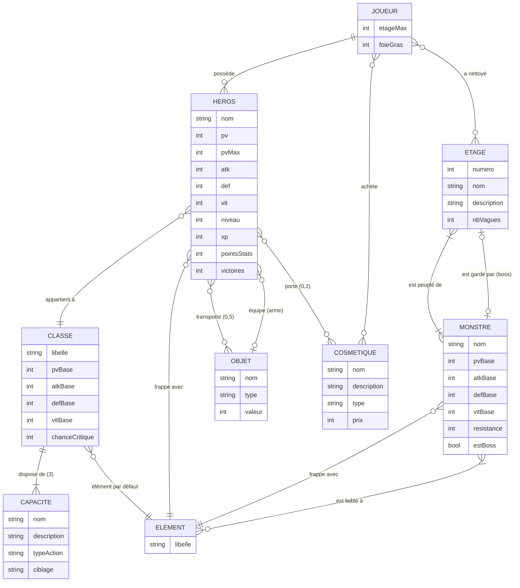
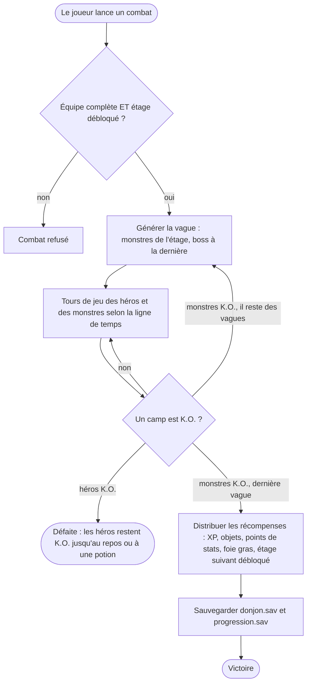
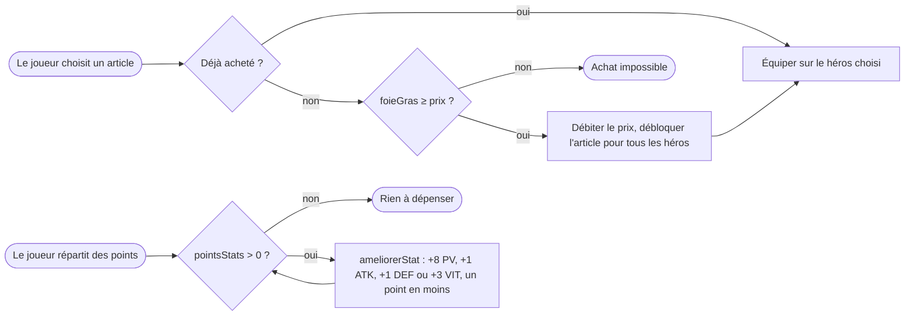

# 🦆 Duckgeon — Chroniques des Canards

**Duckgeon** est un RPG tour par tour écrit en **C** avec **SDL2**. Une équipe de
héros canards descend les 10 étages d'un donjon jusqu'au Canard Noir. Le projet
contient aussi **Le Donjon**, la version console « classique » du sujet (création
de personnages, combats, sauvegarde).


| | |
|---|---|
|  |  |
|  |  |

## Sommaire

1. [Les deux programmes](#les-deux-programmes)
2. [Installation](#installation)
3. [Comment jouer à Duckgeon](#comment-jouer-à-duckgeon)
4. [La version console (Le Donjon)](#la-version-console-le-donjon)
5. [Sauvegardes](#sauvegardes)
6. [Modélisation Merise](#modélisation-merise)
7. [Architecture du code](#architecture-du-code)
8. [Développement](#développement)

---

## Les deux programmes

| Exécutable  | Nom          | Interface        | Contenu                                                                 |
|-------------|--------------|------------------|-------------------------------------------------------------------------|
| `./duckgeon`| **Duckgeon** | Graphique (SDL2) | Combat en équipe, 10 étages, boss, éditeur de canards, boutique, duel local |
| `./donjon`  | **Le Donjon**| Terminal         | Menu du sujet : créer, afficher, combattre, sauvegarder/charger, inventaire, améliorer |

Les deux partagent **la même logique** (`personnage.c`, `inventaire.c`, `donjon.c`,
`sauvegarde.c`...) et **le même fichier de sauvegarde** `donjon.sav` : un héros
créé dans la console se retrouve dans Duckgeon, et inversement.

---

## Installation

### 1. Dépendances

Il faut un compilateur C11 (`gcc` ou `clang`), `make`, `pkg-config`, et pour
Duckgeon **SDL2** et **SDL2_ttf**. La version console n'a besoin de rien d'autre.

| Système            | Commande                                                                |
|--------------------|-------------------------------------------------------------------------|
| Fedora             | `sudo dnf install gcc make pkgconf SDL2-devel SDL2_ttf-devel`           |
| Debian / Ubuntu    | `sudo apt install build-essential pkg-config libsdl2-dev libsdl2-ttf-dev` |
| Arch / Manjaro     | `sudo pacman -S base-devel sdl2 sdl2_ttf`                               |
| macOS (Homebrew)   | `brew install sdl2 sdl2_ttf pkg-config`                                 |
| Windows (MSYS2 UCRT64) | `pacman -S mingw-w64-ucrt-x86_64-gcc mingw-w64-ucrt-x86_64-SDL2 mingw-w64-ucrt-x86_64-SDL2_ttf make pkgconf` |

### 2. Récupérer et compiler

```bash
git clone <url-du-dépôt> duckgeon
cd duckgeon
make            # compile ./duckgeon (graphique) et ./donjon (console)
```

Pour une seule version : `make gui` ou `make console`.

### 3. Lancer

```bash
./duckgeon      # ou : make run-gui
./donjon        # ou : make run
```

**Police** : Duckgeon cherche une police installée (Montserrat, DejaVu,
Liberation, Arial). Si aucune n'est trouvée, placez un fichier
`assets/police.ttf` ou indiquez-en une :
`DONJON_POLICE=/chemin/vers/police.ttf ./duckgeon`.

---

## Comment jouer à Duckgeon

### Premiers pas

1. Au premier lancement, quatre héros vous attendent : Aldric (Guerrier),
   Séléné (Mage), Lysandre (Prêtre) et Kaze (Voleur).
2. **Créer un héros** : choisissez un nom, une classe (8), un élément (7),
   son apparence (plumage, houppette, yeux, coiffe, cape, aura...) et
   répartissez 10 points de stats bonus.
3. **Combattre** : choisissez la taille des équipes (1 à 4), vos héros et
   l'étage, puis lancez le combat.
4. Après chaque victoire : XP, objets, **points de stats** et **foie gras**.
   Améliorez vos héros dans *Mes héros*, dépensez le foie gras à la *Boutique*.

### Les écrans

| Écran                    | Ce qu'on y fait                                                                 |
|--------------------------|----------------------------------------------------------------------------------|
| **Titre**                | Accès à tout, réserve de foie gras, étage maximum débloqué                       |
| **Mes héros**            | Fiche (stats, XP, victoires, capacités, sac), utiliser/jeter un objet, *Améliorer*, *Personnaliser*, *Supprimer*, *Se reposer au camp* (soigne tout le monde) |
| **Éditeur**              | Onglets Identité / Apparence / Statistiques, aperçu animé en direct              |
| **Préparer le combat**   | Mode (bots ou duel), taille des équipes, choix des héros, choix de l'étage       |
| **Combat**               | Tour par tour, voir ci-dessous                                                   |
| **Boutique**             | Acheter des cosmétiques avec le foie gras, les essayer et les équiper            |

### Le combat

Le combat s'inspire de *Honkai: Star Rail* :

- **Ligne de temps** (à gauche) : plus un combattant est rapide (VIT), plus il
  joue souvent.
- **Attaque de base (Q)** : rapporte 1 point de compétence (max 5, partagés par
  l'équipe).
- **Compétence (E)** : coûte 1 point de compétence, effet propre à la classe.
- **Ultime (1 à 4)** : quand la jauge d'énergie est pleine, à lancer à tout
  moment pendant votre tour.
- **Faiblesses** : chaque monstre affiche ses éléments faibles. Le frapper avec
  l'un d'eux vide sa barre blanche ; à zéro il est **brisé** (dégâts bonus, tour
  retardé, effet de l'élément).
- **Boss** : sous 50 % de PV, ils passent en **phase 2** (plus forts, plus agressifs).

| Touche              | Action                              |
|---------------------|-------------------------------------|
| `Q`                 | Attaque de base                     |
| `E`                 | Compétence                          |
| `1` `2` `3` `4`     | Ultime du héros correspondant       |
| `←` `→` ou clic     | Changer de cible                    |
| `Espace` / `Entrée` | Valider                             |
| `Échap`             | Retour / annuler                    |
| `F12`               | Capture d'écran (`capture-*.bmp`)   |

**Duel local** : deux joueurs sur le même PC, chacun son tour. Les héros sont
copiés à PV pleins : aucune conséquence sur le donjon.

### Les classes

| Classe       | PV  | ATK | DEF | VIT | Rôle                                   |
|--------------|-----|-----|-----|-----|----------------------------------------|
| Guerrier     | 120 | 14  | 8   | 95  | Encaisse, frappe en zone, bouclier     |
| Mage         | 80  | 20  | 3   | 100 | Dégâts de zone, météore sur tous       |
| Voleur       | 95  | 16  | 5   | 115 | Poison, rafale de coups aléatoires     |
| Paladin      | 130 | 12  | 10  | 90  | Boucliers d'équipe, soin de groupe     |
| Archer       | 85  | 18  | 4   | 110 | Tir perforant, pluie de flèches        |
| Prêtre       | 90  | 13  | 5   | 98  | Soins, purification, réanimation       |
| Nécromancien | 85  | 18  | 4   | 102 | Drain de vie, malédiction de zone      |
| Barde        | 90  | 14  | 5   | 108 | Bonus d'attaque, fait rejouer un allié |

### Les 10 étages

Chaque victoire débloque l'étage suivant. Les monstres s'adaptent à l'étage, à
la taille de l'équipe et à son niveau moyen.

| Étage | Nom                   | Vagues | Boss              | Mécanique du boss                          |
|-------|-----------------------|--------|-------------------|--------------------------------------------|
| 1     | Les Caves humides     | 2      |                   |                                            |
| 2     | La Champignonnière    | 2      |                   |                                            |
| 3     | Le Trône visqueux     | 3      | Roi des Gelées    | Invoque des gelées en renfort              |
| 4     | L'Ossuaire            | 3      |                   |                                            |
| 5     | La Forge oubliée      | 3      |                   |                                            |
| 6     | La Crypte de la Liche | 3      | Liche             | Frappe toute l'équipe et se soigne         |
| 7     | Les Remparts gris     | 3      |                   |                                            |
| 8     | Le Nid du Dragon      | 4      | Dragon ancien     | Souffle sur l'équipe et brûlure            |
| 9     | L'Abîme               | 4      |                   | (tous les monstres mélangés)               |
| 10    | Le Cœur du Néant      | 4      | **Canard Noir**   | DEF −30 % et vol d'énergie sur l'équipe    |

### Progresser : niveaux, points de stats, foie gras

| Récompense          | Comment l'obtenir                                                     | À quoi ça sert |
|---------------------|-----------------------------------------------------------------------|----------------|
| **XP / niveaux**    | Monstres vaincus (×4 pour un boss). XP requise = 50 × niveau actuel   | +10 PV max, +2 ATK, +1 DEF et soin complet à chaque niveau |
| **Points de stats** | +2 par niveau, +1 par étage nettoyé, +2 de plus si l'étage avait un boss | *Mes héros* → *Améliorer* : +8 PV, +1 ATK, +1 DEF ou +3 VIT par point |
| **Objets**          | Un par vague remportée, donné à un survivant                         | Potions (soin, réanimation) et armes (bonus d'ATK) |
| **Foie gras**       | 4 + 3 × étage, **doublé** avec un boss, **+25** la première fois     | Acheter des cosmétiques à la boutique |

Les points de stats appartiennent à chaque héros. Le foie gras appartient au
joueur, et un cosmétique acheté est disponible pour **tous** les héros.

### La boutique

| Cosmétique        | Type    | Prix |
|-------------------|---------|------|
| Toque de chef     | Coiffe  | 30   |
| Plumage laqué     | Plumage | 40   |
| Haut-de-forme     | Coiffe  | 50   |
| Bicorne de pirate | Coiffe  | 70   |
| Casque viking     | Coiffe  | 90   |
| Plumage doré      | Plumage | 100  |
| Plumage du Néant  | Plumage | 150  |
| Couronne du Néant | Coiffe  | 160  |

Dans la boutique, le héros choisi **essaie** l'article en direct. Une fois
l'article acheté, *Équiper* le lui met ; il apparaît aussi dans l'éditeur.
Avant l'achat, il y est affiché avec un cadenas.

---

## La version console (Le Donjon)

```
===== LE DONJON - GESTION RPG =====
1. Creer un personnage
2. Afficher les personnages
3. Lancer un combat
4. Sauvegarder la partie
5. Charger une partie
6. Inventaire
7. Ameliorer un personnage (points de stats)
0. Quitter
```

- **Combat** : une attaque, ou un combat complet jusqu'au K.O. Le vainqueur gagne
  de l'XP, un objet et un point de stats.
- **Saisies robustes** : `abc`, ligne vide ou nombre hors limites sont refusés,
  et `Ctrl+D` quitte proprement.

---

## Sauvegardes

| Fichier           | Contenu                                               | Écrit par |
|-------------------|-------------------------------------------------------|-----------|
| `donjon.sav`      | Tous les héros (binaire, format v2)                   | Console (menu 4) et Duckgeon (automatique) |
| `progression.sav` | Étage max, foie gras, cosmétiques achetés, étages déjà terminés | Duckgeon (automatique) |

Duckgeon charge les deux fichiers au démarrage. Il sauvegarde à chaque
changement d'écran et en quittant. Les fichiers sont créés dans le dossier
d'où le jeu est lancé.

- **Fiabilité** : l'écriture passe par un fichier temporaire renommé ensuite.
  Un fichier abîmé est refusé sans toucher aux données en mémoire.
- **Compatibilité** : les sauvegardes de l'ancienne version (v1) sont relues ;
  les nouveaux champs valent 0.
- **Repartir de zéro** : `make reset` (supprime les binaires et les sauvegardes).

---

## Modélisation Merise

Le jeu ne repose pas sur une base de données : ses données vivent dans des
structures C et sont sauvegardées dans des fichiers binaires. La méthode
**Merise** sert ici à décrire ces données et ce que le jeu en fait. Le passage
du modèle logique au code est détaillé dans le [modèle physique](#modèle-physique-mpd--correspondance-avec-le-code-c).

### Dictionnaire de données

| Code              | Signification                                   | Type        | Contrainte / règle                        |
|-------------------|-------------------------------------------------|-------------|-------------------------------------------|
| `nom`             | Nom du héros                                    | Texte (29)  | Non vide                                  |
| `pv`, `pvMax`     | Points de vie actuels / maximum                 | Entier      | 0 ≤ pv ≤ pvMax                            |
| `atk`, `def`, `vit` | Attaque, défense, vitesse                     | Entier      | > 0                                       |
| `niveau`, `xp`    | Niveau et XP dans le niveau                     | Entier      | niveau ≥ 1, xp < 50 × niveau              |
| `pointsStats`     | Points de stats à répartir                      | Entier      | ≥ 0                                       |
| `victoires`       | Combats gagnés par le héros                     | Entier      | ≥ 0                                       |
| `plumage`, `coupe`, `coiffe`... | Options d'apparence (13 indices)  | Entier      | Option payante ⇒ cosmétique acheté        |
| `libelleClasse`   | Guerrier, Mage...                               | Texte       | 8 valeurs                                 |
| `libelleElement`  | Physique, Feu, Glace, Foudre, Vent, Quantique, Imaginaire | Texte | 7 valeurs                          |
| `nomObjet`, `typeObjet`, `valeur` | Objet du sac (soin ou arme)     | Texte, énum, entier | Sac de 5 objets max            |
| `nomCapacite`, `typeAction`, `ciblage` | Capacité d'une classe      | Texte, énum | 3 par classe (basique, compétence, ultime) |
| `numeroEtage`, `nomEtage`, `nbVagues` | Étage du donjon             | Entier, texte | 1 ≤ numéro ≤ 10                       |
| `nomMonstre`, `resistance`, `estBoss` | Monstre et sa barre de résistance | Texte, entier, booléen |                      |
| `etageMax`        | Plus haut étage débloqué                        | Entier      | 1 à 10                                    |
| `foieGras`        | Monnaie du joueur                               | Entier      | ≥ 0                                       |
| `nomCosmetique`, `prix` | Article de la boutique                    | Texte, entier | prix > 0                                |

### MCD — Modèle conceptuel des données



Cardinalités en notation Merise :

| Association            | Entité A   | Card. A | Entité B   | Card. B | Remarque                              |
|------------------------|------------|---------|------------|---------|---------------------------------------|
| POSSÉDER               | JOUEUR     | 0,n     | HEROS      | 1,1     | Le donjon du joueur                   |
| APPARTENIR             | HEROS      | 1,1     | CLASSE     | 0,n     |                                       |
| FRAPPER_AVEC (héros)   | HEROS      | 1,1     | ELEMENT    | 0,n     | Choisi dans l'éditeur                 |
| DISPOSER               | CLASSE     | 3,3     | CAPACITE   | 1,1     | Basique, compétence, ultime           |
| TRANSPORTER            | HEROS      | 0,5     | OBJET      | 0,n     | Attribut : position dans le sac       |
| ÉQUIPER                | HEROS      | 0,1     | OBJET      | 0,n     | Arme équipée                          |
| ACHETER                | JOUEUR     | 0,n     | COSMETIQUE | 0,n     |                                       |
| PORTER                 | HEROS      | 0,2     | COSMETIQUE | 0,n     | Une coiffe, un plumage ; seulement si acheté |
| NETTOYER               | JOUEUR     | 0,n     | ETAGE      | 0,n     | Bonus de premier passage              |
| PEUPLER                | ETAGE      | 1,n     | MONSTRE    | 1,n     | Monstres pouvant apparaître           |
| GARDER                 | ETAGE      | 0,1     | MONSTRE    | 0,1     | Boss de la dernière vague             |
| ÊTRE_FAIBLE            | MONSTRE    | 1,n     | ELEMENT    | 0,n     |                                       |
| FRAPPER_AVEC (monstre) | MONSTRE    | 1,1     | ELEMENT    | 0,n     |                                       |

**Règles de gestion** :

- RG1 — Un héros a une classe et un élément ; il commence niveau 1 avec une potion.
- RG2 — Le sac d'un héros contient au plus 5 objets ; il équipe au plus une arme.
- RG3 — À chaque niveau, un héros gagne 2 points de stats ; à chaque étage nettoyé, 1 point (+2 avec un boss).
- RG4 — Un point de stats se dépense une seule fois, sur une statistique au choix.
- RG5 — Le foie gras gagné vaut `4 + 3 × étage`, doublé si l'étage a un boss, +25 au premier passage.
- RG6 — Un cosmétique ne s'achète qu'une fois, si le joueur a assez de foie gras ; il sert alors à tous ses héros.
- RG7 — Un héros ne porte un cosmétique payant que si le joueur l'a acheté.
- RG8 — Un étage n'est accessible que si l'étage précédent a été nettoyé.

### MLD — Modèle logique des données

Chaque relation est donnée avec sa clé primaire et ses clés étrangères (`#`).

| Relation      | Clé primaire               | Attributs                                                                 | Clés étrangères |
|---------------|----------------------------|---------------------------------------------------------------------------|-----------------|
| JOUEUR        | idJoueur                   | etageMax, foieGras                                                        |                 |
| ELEMENT       | idElement                  | libelle                                                                   |                 |
| CLASSE        | idClasse                   | libelle, pvBase, atkBase, defBase, vitBase, chanceCritique                | #idElementDefaut → ELEMENT |
| CAPACITE      | idCapacite                 | nom, description, typeAction, ciblage                                     | #idClasse → CLASSE |
| HEROS         | idHeros                    | nom, pv, pvMax, atk, def, vit, niveau, xp, pointsStats, victoires, plumage, coupe, couleurCheveux, couleurYeux, regard, tenue, tenue2, coiffe, pilosite, marque, cape, aura, corpulence | #idJoueur → JOUEUR, #idClasse → CLASSE, #idElement → ELEMENT, #idArme → OBJET (peut être NULL) |
| OBJET         | idObjet                    | nom, type, valeur                                                         |                 |
| TRANSPORTER   | (#idHeros, position)       | position de 1 à 5                                                         | #idHeros → HEROS, #idObjet → OBJET |
| COSMETIQUE    | idCosmetique               | nom, description, type, valeurApparence, prix                             |                 |
| ACHETER       | (#idJoueur, #idCosmetique) |                                                                           | #idJoueur → JOUEUR, #idCosmetique → COSMETIQUE |
| ETAGE         | numero                     | nom, description, nbVagues                                                | #idBoss → MONSTRE (peut être NULL) |
| NETTOYER      | (#idJoueur, #numeroEtage)  |                                                                           | #idJoueur → JOUEUR, #numeroEtage → ETAGE |
| MONSTRE       | idMonstre                  | nom, pvBase, atkBase, defBase, vitBase, resistance, attaque, special, chanceSpecial, estBoss | #idElement → ELEMENT |
| PEUPLER       | (#numeroEtage, #idMonstre) |                                                                           | #numeroEtage → ETAGE, #idMonstre → MONSTRE |
| ETRE_FAIBLE   | (#idMonstre, #idElement)   |                                                                           | #idMonstre → MONSTRE, #idElement → ELEMENT |

Écriture textuelle équivalente (clé primaire entre crochets) :

```
JOUEUR      ([idJoueur], etageMax, foieGras)
ELEMENT     ([idElement], libelle)
CLASSE      ([idClasse], libelle, pvBase, atkBase, defBase, vitBase, chanceCritique, #idElementDefaut)
CAPACITE    ([idCapacite], nom, description, typeAction, ciblage, #idClasse)
HEROS       ([idHeros], nom, pv, pvMax, atk, def, vit, niveau, xp, pointsStats, victoires,
             plumage, coupe, couleurCheveux, couleurYeux, regard, tenue, tenue2, coiffe,
             pilosite, marque, cape, aura, corpulence, #idJoueur, #idClasse, #idElement, #idArme)
OBJET       ([idObjet], nom, type, valeur)
TRANSPORTER ([#idHeros, position], #idObjet)
COSMETIQUE  ([idCosmetique], nom, description, type, valeurApparence, prix)
ACHETER     ([#idJoueur, #idCosmetique])
ETAGE       ([numero], nom, description, nbVagues, #idBoss)
NETTOYER    ([#idJoueur, #numeroEtage])
MONSTRE     ([idMonstre], nom, pvBase, atkBase, defBase, vitBase, resistance,
             attaque, special, chanceSpecial, estBoss, #idElement)
PEUPLER     ([#numeroEtage, #idMonstre])
ETRE_FAIBLE ([#idMonstre, #idElement])
```

Les associations 1,1 deviennent des clés étrangères dans la table côté « 1,1 ».
Les associations n,n deviennent des tables (ACHETER, NETTOYER, PEUPLER,
ETRE_FAIBLE, TRANSPORTER). L'association PORTER est représentée par les colonnes
`coiffe` et `plumage` de HEROS, contrôlées par la règle RG7.

### Modèle physique (MPD) : correspondance avec le code C

| Table logique         | Représentation dans le code                                     | Stockage            |
|-----------------------|-----------------------------------------------------------------|---------------------|
| HEROS                 | `struct Personnage` (+ `Apparence`) dans le tableau dynamique `Donjon` | `donjon.sav`  |
| TRANSPORTER / ÉQUIPER | `Objet inventaire[5]`, `int nbObjets`, `Objet arme` dans `Personnage` | `donjon.sav`  |
| JOUEUR, ACHETER, NETTOYER | `Progression` : `etageMax`, `foieGras`, masques de bits `cosmetiques` et `etagesNettoyes` | `progression.sav` |
| CLASSE                | `enum Classe` + table `STATS_CLASSE[]` (`personnage.c`)         | Constantes du code  |
| ELEMENT               | `enum Element`                                                  | Constantes du code  |
| CAPACITE              | Table `CAPACITES[classe][action]` (`combat.c`)                  | Constantes du code  |
| OBJET                 | Table `TABLE_BUTIN[]` (`objet.c`)                               | Constantes du code  |
| COSMETIQUE            | Table `CATALOGUE[]` (`boutique.c`)                              | Constantes du code  |
| ETAGE, PEUPLER        | Table `ETAGES[]` de `InfoEtage` (`combat.c`)                    | Constantes du code  |
| MONSTRE, ETRE_FAIBLE  | Table `MONSTRES[]`, faiblesses en masque de bits (`combat.c`)   | Constantes du code  |

Choix de conception :

- Les **clés étrangères** vers les tables de référence sont des **indices
  d'énumération** (`enum Classe`, `enum Element`...), pas des pointeurs. Une
  structure sans pointeur s'écrit telle quelle avec `fwrite` et se relit sans
  correction.
- Les **associations n,n de petite taille** (cosmétiques achetés, étages
  nettoyés, faiblesses) sont des **masques de bits** : `1u << i` vaut 1 si le
  lien existe.
- Les **données de référence** (classes, monstres, étages, catalogue) sont des
  tables constantes. On les modifie dans le code, pas pendant la partie.

### MCT — Modèle conceptuel des traitements

**Opération « Combattre un étage »**



**Opérations « Acheter un cosmétique » et « Améliorer un héros »**



---

## Architecture du code

```
include/                         src/
├── personnage.h   ─────────────  personnage.c   héros, classes, XP, points de stats
├── objet.h        ─────────────  objet.c        objets et table de butin
├── inventaire.h   ─────────────  inventaire.c   sac, arme équipée
├── donjon.h       ─────────────  donjon.c       tableau dynamique (malloc/realloc/free)
├── sauvegarde.h   ─────────────  sauvegarde.c   fichiers binaires, compatibilité v1/v2
├── boutique.h     ─────────────  boutique.c     foie gras, catalogue, achats
├── saisie.h       ─────────────  saisie.c       saisies clavier sûres (console)
├── main.h         ─────────────  main.c         menu console « Le Donjon »
├── combat.h       ─────────────  combat.c       moteur de combat, étages, monstres, boss
├── gui.h          ─────────────  gui.c, gui_formes.c   fenêtre SDL, texte, widgets, formes
├── gui_sprite.h   ─────────────  gui_sprite.c   dessin vectoriel des canards et monstres
└── gui_app.h      ─────────────  gui_main.c     main de Duckgeon, écran titre
                                  gui_heros.c    Mes héros, Préparer le combat
                                  gui_editeur.c  éditeur de héros
                                  gui_combat.c   écran de combat et de victoire
                                  gui_boutique.c boutique
docs/
├── RAPPORT.md       rapport technique (choix, questions de réflexion, tests)
└── captures/        captures d'écran
```

- La **logique** (au-dessus de `combat.h`) ne dépend pas de SDL : elle est
  partagée par les deux programmes et testable sans fenêtre.
- Le **moteur de combat** applique les règles et décrit chaque action par une
  liste d'effets ; l'interface se contente de les animer.
- Tous les personnages sont **dessinés en vectoriel** à partir de leur
  `Apparence`, sans aucune image : chaque option de l'éditeur s'affiche
  immédiatement.

---

## Développement

```bash
make            # tout compiler (-std=c11 -Wall -Wextra -Wpedantic)
make console    # seulement ./donjon
make gui        # seulement ./duckgeon
make valgrind   # console sous valgrind (fuites mémoire)
make clean      # supprime build/ et les exécutables
make reset      # clean + supprime les sauvegardes
```

Le rapport du projet (choix réalisés, réponses aux questions de réflexion,
tests effectués) se trouve dans [`docs/RAPPORT.md`](docs/RAPPORT.md).
